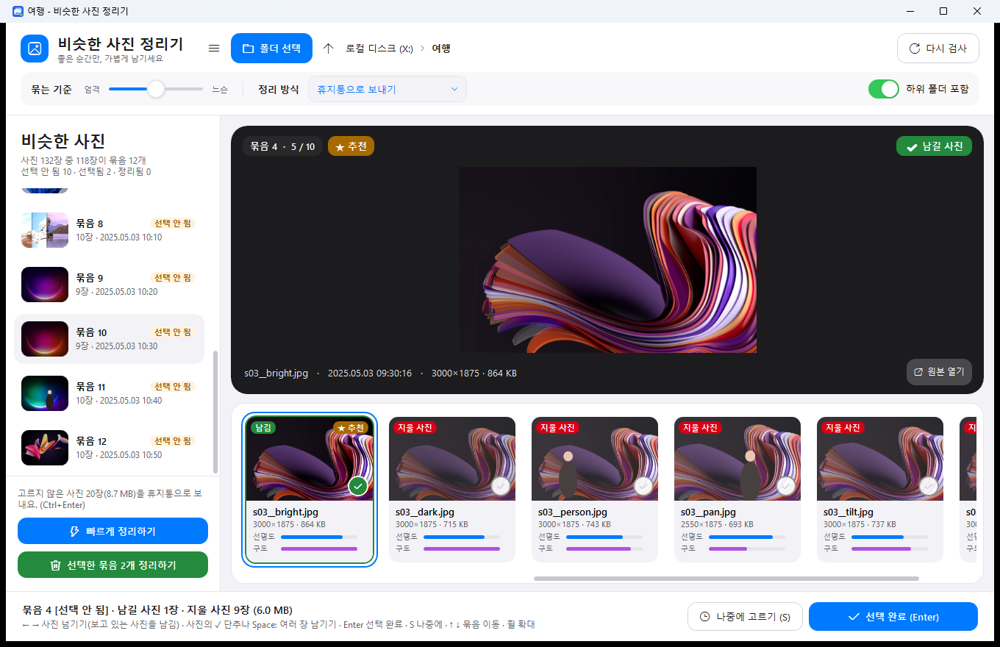

# 비슷한 사진 정리기

같은 장소·같은 구도로 여러 번 찍은 사진을 자동으로 묶어 보여 주고, 고른 사진만 남기고 나머지를 정리하는 Windows 프로그램입니다.



## 내려받기

**[최신 버전 받기 (SimilarPhotoCleaner.exe)](https://github.com/sdjeon93-sudo/SimilarPhotoCleaner/releases/latest)**

- 설치 없이 바로 실행됩니다 (Windows 10/11 64비트).
- 처음 실행할 때 'Windows의 PC 보호' 창이 뜨면 **추가 정보 → 실행**을 누르세요. 서명하지 않은 프로그램이라 나오는 안내입니다.
- 폴더를 exe 아이콘이나 프로그램 창에 끌어다 놓아도 바로 검사합니다.
- **자동 업데이트**: 프로그램을 켜면 하루 두 번까지 새 버전을 확인합니다. 새 버전이 있으면 위쪽에 알림이 뜨고, **업데이트**를 누르면 새 버전을 받아 스스로 바꾼 뒤 다시 열립니다. 왼쪽 아래 **업데이트 확인**으로 직접 확인할 수도 있습니다.

## 사용법

1. **맨 왼쪽 폴더 목록**에서 폴더를 누르면(탐색기처럼 휴대폰·사진·바탕 화면·다운로드·드라이브를 차례로 펼쳐 들어갈 수 있음) 그 폴더의 사진을 분석해 비슷한 사진끼리 묶습니다. '폴더 선택' 단추나 창에 끌어다 놓기도 됩니다.
   - 폴더 이름 오른쪽 숫자는 그 폴더 바로 안의 사진 수입니다.
   - 위쪽 주소 표시줄의 경로를 누르거나 ↑ 단추(Alt+↑)로 상위 폴더로 갈 수 있습니다.
   - '하위 폴더 포함'을 끄면 폴더별로 하나씩 들어가며 정리할 수 있습니다.
   - 맨 왼쪽 위 ☰ 단추로 폴더 목록을 숨기거나 보일 수 있습니다.
2. 묶음마다 아래 사진 띠에서 **남길 사진을 클릭**하고 **Enter**를 누르면 그 묶음은 **선택됨**이 되고 다음 묶음으로 넘어갑니다.
   처음에는 선명도와 구도가 가장 좋은 사진(★ 추천)이 골라져 있습니다.
   **여러 장을 남기려면** 사진 오른쪽 아래의 동그란 **✓ 단추**(또는 Space)를 누르세요. 누를 때마다 그 사진만 남기기에 더해지거나 빠집니다.
   여러 장을 골라 둔 상태에서는 사진을 눌러도 고른 것이 바뀌지 않고 크게 보기만 바뀝니다.
3. 지금 고르기 어려운 묶음은 **S(나중에 고르기)** 를 누르면 **선택 안 됨**으로 남겨 두고 넘어갑니다.
4. 다 고른 뒤 왼쪽 아래 **선택한 묶음 정리하기**(Ctrl+Enter)를 누르면, 선택됨 묶음에서 고르지 않은 사진을 한꺼번에 정리합니다.
   정리하기 전에는 언제든 묶음을 다시 눌러 고른 사진을 바꿀 수 있습니다.
5. 하나하나 고르기 번거로우면 왼쪽 아래 **빠르게 정리하기**를 누르세요. '선택 안 됨' 묶음마다 **선명도와 구도가 좋은 사진**을 골라 남기고 나머지를 정리합니다.
   - 사진이 2~3장인 묶음은 1장, 4~6장은 2장, 7장 이상은 3장을 남깁니다.
   - 이미 골라 둔 '선택됨' 묶음은 고른 대로 정리합니다.
   - 확인 창에서 **아니요**를 고르면 정리하지 않고 골라 두기만 합니다. 묶음을 눌러 살펴본 뒤 '선택한 묶음 정리하기'로 정리하면 됩니다.
   - 선명도 계산이 덜 끝났으면 끝날 때까지 기다렸다가 고릅니다.

왼쪽 목록의 표시: <kbd>선택 안 됨</kbd>(주황) · <kbd>선택됨</kbd>(파랑) · <kbd>정리됨</kbd>(초록)

| 키 | 동작 |
|---|---|
| ← → | 사진 넘기기 (보고 있는 사진이 남길 사진이 됨) |
| ✓ 단추 / Space / Ctrl+클릭 | 이 사진도 남기기 (여러 장 남기기) · 큰 화면의 '남길 사진/지울 사진' 표시를 눌러도 됨 |
| Enter | 선택 완료하고 다음 '선택 안 됨' 묶음으로 |
| S | 나중에 고르기 (선택됨 묶음이면 선택 취소) |
| Ctrl+Enter | 선택한 묶음 한꺼번에 정리 |
| ↑ ↓ | 이전/다음 묶음 |
| 마우스 휠 / 더블클릭 | 크게 보기 (사진을 넘겨도 확대 위치 유지) · Esc로 원래대로 |
| Ctrl+Z | 방금 정리한 것 되돌리기 ('_지운 사진' 폴더로 옮기기 방식일 때) |
| Ctrl+O | 폴더 열기 |
| Alt+↑ | 상위 폴더로 |

정리하지 않은 '선택됨' 묶음이 있는 채로 창을 닫거나 다른 폴더를 열면, 먼저 정리할지 물어봅니다.

## 속도

- **빠른 1차 분석**: 휴대폰·카메라 JPEG에는 파일 앞부분에 작은 미리보기(EXIF 썸네일)가 들어 있습니다. 묶을 때는 파일 앞 256KB만 읽어 이 미리보기로 비교합니다. 사진 전체(3~5MB)를 읽지 않아서 구글 드라이브에서도 빠릅니다.
- **묶인 사진만 2차 분석**: 선명도와 선명한 썸네일은 묶음에 든 사진만, 보고 있는 묶음부터 뒤에서 계산합니다. 계산 중에는 카드에 '계산 중…'이 보입니다.
- **분석 결과 저장**: 한 번 분석한 사진은 `%LocalAppData%\SimilarPhotoCleaner\cache`에 저장해 두고, 파일이 바뀌지 않았으면 다시 분석하지 않습니다(90일 동안 안 쓰면 자동 삭제).

4코어로 제한한 시험에서 사진 900장을 불러오는 시간: 이전 버전 14.9초 → 처음 4.5초, 다시 열 때 1.4초.

## 지운 사진은 어디로?

- **휴지통으로 보내기**(기본): 휴지통에서 되살릴 수 있습니다. 휴지통이 없는 드라이브(USB·네트워크 등)에서는 영구 삭제 전에 Windows가 먼저 물어봅니다.
- **'_지운 사진' 폴더로 옮기기**: 고른 폴더 안의 `_지운 사진` 폴더로 옮깁니다. 프로그램 안에서 되돌리기가 됩니다.

## 휴대폰 사진 정리하기 (휴대폰 연결 · Phone Link)

Windows의 '휴대폰과 연결'로 휴대폰을 연결하면, 폴더 목록 맨 위에 **휴대폰 · (휴대폰 이름)** 이 나옵니다. 휴대폰 사진도 PC 폴더처럼 묶고 정리할 수 있습니다.

다만 휴대폰의 사진 폴더(DCIM)는 보호되어 있습니다. 휴대폰의 **'Windows와 연결' 앱에 '모든 파일 관리' 권한**이 없으면 카메라가 찍은 사진을 PC에서 지우거나 옮길 수 없습니다. 이 경우 Windows 탐색기에서도 '클라우드 파일 액세스가 거부되었습니다(0x8007018B)' 오류가 납니다. 다운로드 폴더처럼 보호되지 않는 곳은 권한 없이도 정리됩니다.

휴대폰에서 권한 주기 (메뉴 이름은 휴대폰마다 조금 다를 수 있음):
1. 설정 → 애플리케이션 → **Windows와 연결** → 권한
2. '파일 및 미디어'(또는 '저장공간') → **모든 파일 관리 허용**
   - 안 보이면: 설정 → 애플리케이션 → 오른쪽 위 ⋮ → **특별한 접근** → **모든 파일 접근** → 'Windows와 연결' 켜기
3. 프로그램에서 정리가 막혔다는 안내가 나오면 **다시 시도**를 누릅니다. 고른 묶음은 '선택됨'으로 남아 있어서 다시 고를 필요가 없습니다.

## 비슷한 사진을 고르는 방법

- **구도 지문(pHash)**: 사진을 32×32 흑백으로 줄여서 큰 구도를 64비트 지문으로 만듭니다. 밝기가 다르거나, 약간 흔들리거나, 사람이 지나가도 비슷하게 나옵니다. 가운데 80% 영역 지문도 함께 비교해서 조금 당겨 찍은 사진도 잡아냅니다.
- **색 분포**: 밝기와 상관없는 색 비율을 비교해서, 구도는 같고 색만 완전히 다른 사진은 따로 둡니다.
- **촬영 시간**: EXIF 촬영 시간이 3분 이내인 사진은 조금 더 너그럽게 묶습니다.
- **묶는 기준** 슬라이더(1~5)로 얼마나 비슷해야 묶을지 고릅니다. 기본값은 3입니다.

## 남길 사진을 고르는 방법 (★ 추천 · 빠르게 정리하기)

사진 카드의 **선명도**와 **구도** 막대로 점수를 매깁니다. 점수 = 선명도 40% + 구도 40% + 해상도 20%.

- **선명도**: 가장자리가 또렷한 정도입니다. 밝기에 따라 달라지지 않게 맞춰서, 밝게 찍힌 사진을 더 선명하다고 보지 않습니다.
- **구도**: 두 가지를 반씩 봅니다.
  - **수평**: 건물·수평선처럼 곧은 선이 뚜렷한 사진은 기울었는지 잽니다. 3° 이상 기울면 0점입니다. 곧은 선이 없는 사진(풀숲·하늘 등)은 기울기를 따지지 않습니다.
  - **비슷한 구도**: 묶음의 다른 사진들과 구도가 비슷할수록 높습니다. 사람이 끼어들었거나 혼자 많이 비뚤어진 사진이 낮게 나옵니다.
- 얼굴 표정이나 눈 감김은 보지 않습니다. 중요한 사진은 '아니요(골라 두기만)'로 확인한 뒤 정리하세요.

지원 형식: JPG, PNG, BMP, GIF, TIFF, WEBP, HEIC/HEIF (HEIC는 Microsoft Store의 'HEIF 이미지 확장'이 필요합니다)

## 직접 빌드

.NET 8 SDK가 필요합니다. 아래 스크립트를 실행하면 `SimilarPhotoCleaner.exe`가 이 폴더에 만들어집니다.

```bash
powershell -ExecutionPolicy Bypass -File tools/build.ps1
```

이 폴더는 구글 드라이브 안에 있어서, 빌드 중간 파일(bin, obj)은 `Directory.Build.props` 설정으로 `%LocalAppData%\SimilarPhotoCleaner-build`에 만들어집니다. 구글 드라이브 폴더에서 직접 빌드했더니 동기화와 얽혀 실행 파일이 깨진 적이 있습니다. 그래서 스크립트는 로컬 폴더에서 빌드한 뒤 완성된 exe만 복사합니다.

`tools/` 폴더에는 개발용 도구가 있습니다.
- `build.ps1`: 배포용 exe 만들기
- `Harness`: 묶기 정확도·속도 시험
  - `gen <폴더>`: 카메라처럼 EXIF 썸네일을 넣은 시험 사진 만들기
  - `test <폴더>`: 단계별 묶기 결과 보기
  - `biggen` / `bench <폴더>`: 4000×3000 사진으로 속도 재기
  - `tilt <폴더>`: 기울기 측정 시험 · `quick <폴더>`: 빠르게 정리하기가 남길 사진 보기
- `uitest.ps1`: 화면 자동 점검(선택 → 정리 → 되돌리기 → 닫기)
- `quicktest.ps1`: 빠르게 정리하기 점검(골라 두기만 → 정리 → 되돌리기 → 바로 정리)
- `make-icon.ps1`: 아이콘 생성
